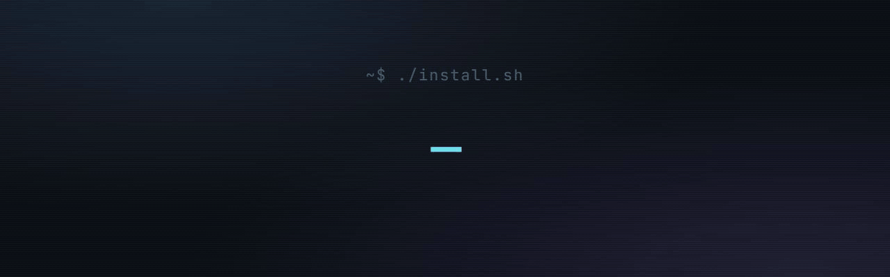
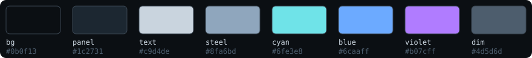
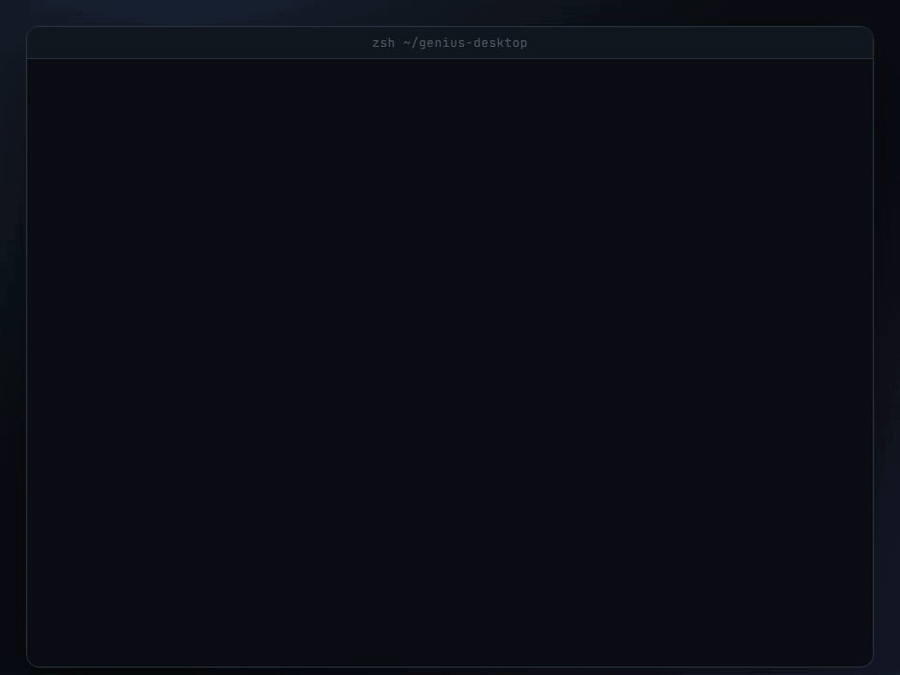
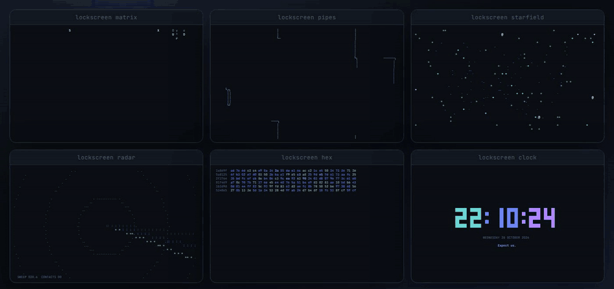
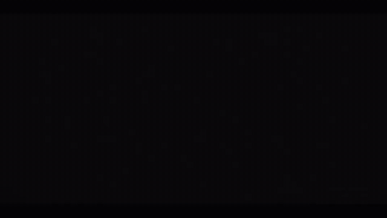
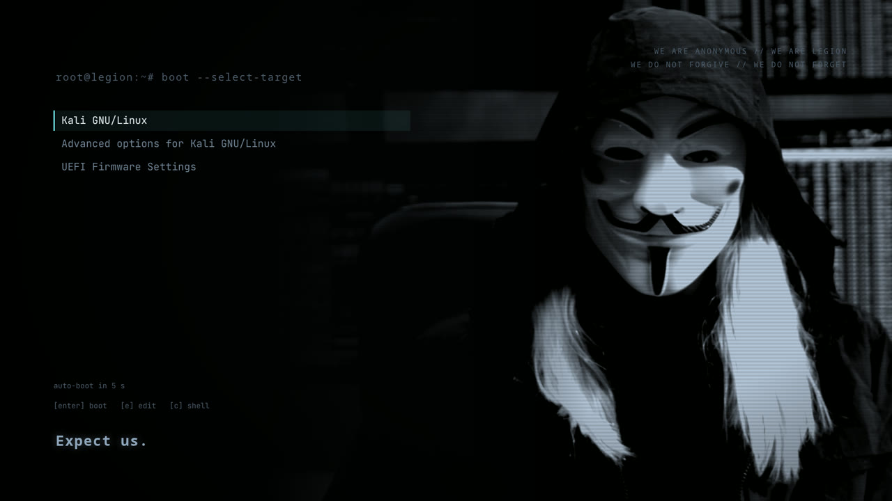
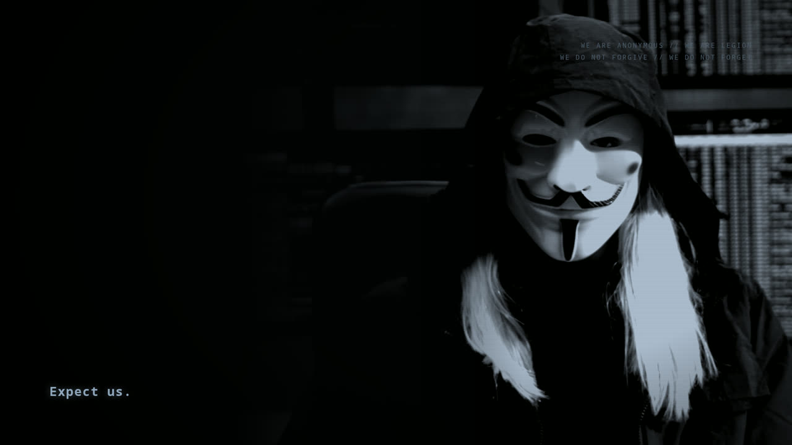

<p align="center">
  
</p>

<p align="center">
  <code>git clone https://github.com/ZenithGenius/genius-desktop.git && ./genius-desktop/install.sh</code><br>
  <sub>3 layers · 20+ themed tools · tested on Ubuntu 26.04 and Kali 2026.3 · every change previewable with <code>--dry-run</code></sub>
</p>

<p align="center">
  <a href="https://zenithgenius.github.io/genius-desktop/"></a>
  
  
  
  
</p>

<p align="center">
  <a href="#quick-start">Quick start</a> ·
  <a href="#terminal">Terminal</a> ·
  <a href="#workspaces-and-lock-screens">Workspaces</a> ·
  <a href="#desktop">Desktop</a> ·
  <a href="#boot-and-login">Boot</a> ·
  <a href="#undo">Undo</a> ·
  <a href="#credits">Credits</a>
</p>

---

## Quick start

```bash
git clone https://github.com/ZenithGenius/genius-desktop.git
cd genius-desktop
./install.sh --dry-run   # see every change first, touch nothing
./install.sh             # terminal + desktop (desktop only if GNOME is installed)
```

Open a new terminal. Type `cheat` for the cheat sheet.

Want the boot splash, GRUB menu and login wallpaper too?

```bash
./install.sh --boot
```

| Option | Does |
|---|---|
| *(none)* | Terminal layer, plus the desktop layer when GNOME is present |
| `--dry-run` | Prints every package, file and setting it would change, then stops |
| `--no-desktop` | Terminal layer only (servers, SSH boxes, other desktops) |
| `--boot` | Adds the system-wide boot splash, GRUB theme and login screen |

The script is safe to run again. Every file it replaces is kept next to the original as `NAME.bak-genius-DATE`.

## What you get

<table>
<tr><th>Layer</th><th>What changes</th><th>Needs</th></tr>
<tr><td><b>Terminal</b></td><td>zsh with starship prompt, banner and fastfetch, eza, bat, fzf, zoxide, yazi, lazygit, glow, btop, cava, tldr, asciinema, themed tmux with workspaces and animated lock screens, Ghostty config</td><td>Any Debian family system, desktop or not</td></tr>
<tr><td><b>Desktop</b></td><td>Dark mode, Papirus icons with cyan folders, Bibata cursor, quiet sound theme, Conky HUD, Desktop Cube with a nebula sky box, Coverflow Alt-Tab, Burn My Windows effects, Vitals</td><td>GNOME 45 or newer</td></tr>
<tr><td><b>Boot</b></td><td>Animated Plymouth splash, GRUB menu theme, login screen wallpaper</td><td><code>--boot</code>, GRUB and GDM</td></tr>
</table>

<p align="center"></p>

## Terminal

<p align="center"></p>

| Command | What it does |
|---|---|
| `ls` `ll` `la` `lt` | eza listings in the palette: git status, relative dates, tree view |
| `cat file` | bat with syntax highlighting; plain text in pipes |
| `Ctrl+R` `Ctrl+T` `Alt+C` | fzf history search, file picker, jump into a subfolder |
| `z proj` / `zi` | zoxide: jump to a folder you use often, or pick one from a list |
| `y` | yazi file manager; quitting leaves you in the folder you browsed to |
| `lazygit` | git dashboard |
| `glow file.md` | Markdown rendered in the terminal |
| `btop` | system monitor with the matching theme |
| `tldr cmd` | short practical examples for any command |
| `asciinema rec demo.cast` | record a terminal session (idle gaps trimmed on replay) |
| `cava` / `cava-idle` | music visualizer; `cava-idle` animates without any audio |
| `cheat` | the full cheat sheet |

Commands that run 30 seconds or longer send a desktop notification when they finish ("Done in 2m 14s" or "Failed (exit 1)").

The prompt is a two-line starship frame with user, host, path, git state, language versions and time. A `● vpn` tag appears while a VPN tunnel is up.

## Workspaces and lock screens

`mission` turns tmux into named workspaces: a main shell, btop beside it, and a Markdown notes window. Workspaces survive reboots because each mission remembers its folder in its notes file.

```bash
mission                 # pick one: running missions first, then saved ones
mission recon ~/lab     # create or resume "recon" in ~/lab
```

| Keys | Does |
|---|---|
| `Ctrl+B` then `\|` | split side by side |
| `Ctrl+B` then `-` | split top and bottom |
| `Ctrl+B` then arrows | move between panes (or click) |
| `Ctrl+B` then `d` | detach; everything keeps running |

After 5 idle minutes tmux locks with one of six animations. Any key returns. Preview them with `lockscreen NAME`.

<p align="center"></p>

## Desktop

Installed only when GNOME is present. Extensions come from extensions.gnome.org for your exact GNOME version and switch on at the next login.

<table>
<tr>
<td align="center" width="33%"><br><sub>Desktop Cube</sub></td>
<td align="center" width="33%"><br><sub>Burn My Windows: Hexagon (open)</sub></td>
<td align="center" width="33%"><br><sub>Burn My Windows: Matrix (close)</sub></td>
</tr>
<tr>
<td align="center"><br><sub>Burn My Windows: Fire (close)</sub></td>
<td align="center"><br><sub>Burn My Windows: Broken glass (close)</sub></td>
<td align="center"><br><sub>Coverflow Alt-Tab</sub></td>
</tr>
</table>

<sub>Demo clips come from the extensions' own repositories, shown here by link: Desktop Cube and Burn My Windows by Simon Schneegans, Coverflow Alt-Tab by dsheeler and contributors (all GPL-3.0). They use the authors' default themes; with genius-desktop the same effects run on the dark palette.</sub>

| Piece | Details |
|---|---|
| Theme | Dark mode, slate accent (Yaru-dark on Ubuntu) |
| Icons | Papirus-Dark with cyan folders, built locally as a small user theme |
| Cursor | Bibata Modern Classic |
| Sounds | "Anonymous": short cold blips, no login sound |
| Conky HUD | Top right: CPU, temperature, RAM, disk, network |
| Desktop Cube | `Ctrl+Alt+Left/Right` in Activities, nebula sky box |
| Coverflow Alt-Tab | 3D window carousel on `Alt+Tab` |
| Burn My Windows | Quick effects on open (Hexagon, Glitch, TV...), dramatic ones on close (Matrix, Fire, Broken glass...) |
| Vitals | Temperature, load and memory in the top bar |

## Boot and login

`./install.sh --boot` adds the system pieces. It asks for sudo, backs up `/etc/default/grub`, then:

- installs the Plymouth splash and rebuilds the initramfs
- sets the GRUB theme and runs `update-grub`
- on GDM systems, installs the login wallpaper through [gse-gdm-extension](https://github.com/pratap-panabaka/gse-gdm-extension), pinned to a reviewed commit

<p align="center"></p>

<p align="center">
  
  
</p>

## Customize

| Variable | Effect |
|---|---|
| `GENIUS_BANNER="#hacker"` | Text of the startup banner (default `#yourname`) |
| `GENIUS_QUIET=1` | No banner or fastfetch when a terminal opens |

Set them in `~/.zshrc` above the `genius-desktop` line. Every other setting lives in a plain config file:

| File | Controls |
|---|---|
| `~/.config/genius-desktop/genius.zsh` | aliases, fzf colors, notifications, shell functions |
| `~/.config/starship.toml` | prompt |
| `~/.config/fastfetch/config.jsonc` | system info block |
| `~/.tmux.conf` | tmux theme, keys, lock timer |
| `~/.config/ghostty/config` | Ghostty terminal colors and keys |
| `~/.config/conky/anonymous.conf` | desktop HUD |
| `~/.config/burn-my-windows/profiles/` | open and close window effects |

Edit the copy in the repo instead and run `./install.sh` again to redeploy.

## Undo

- **Terminal**: delete the `genius-desktop` line at the end of `~/.zshrc`. Restore any replaced file from its `.bak-genius-DATE` copy.
- **Desktop**: switch icons, cursor and sounds back in Settings, and turn extensions off in the Extensions app.
- **Boot**: delete `/etc/default/grub.d/zz-genius.cfg`, restore `/etc/default/grub` from its backup, run `sudo update-grub`, then `sudo plymouth-set-default-theme -R bgrt` (or your previous theme). For the login screen, run `sudo ./uninstall.sh` from a clone of gse-gdm-extension.

## Troubleshooting

<details>
<summary>The prompt or banner did not change</summary>

Open a **new** terminal, or run `exec zsh`. The installer switches your login shell to zsh; that takes effect at the next login.
</details>

<details>
<summary>Extensions are installed but not running</summary>

GNOME loads new extensions at login. Log out and back in. Run `gnome-extensions list --enabled` to check.
</details>

<details>
<summary>A package was "not in your repos"</summary>

The installer skips anything your release does not ship and keeps going. starship and yazi fall back to their official release binaries. Ghostty is installed when your release packages it. Otherwise its config waits until you install Ghostty from ghostty.org.
</details>

<details>
<summary>The login screen keeps the distribution's wallpaper (Kali)</summary>

The login wallpaper relies on gse-gdm-extension. It works on Ubuntu. On Kali 2026 the greeter runs as its own `gdm-greeter` user and does not load the extension, even though the settings are in place. The rest of `--boot` (splash and GRUB) works there. Kali users can set the login background through Kali's own theme packages instead.
</details>

<details>
<summary>Kali: "the repository is not signed" (NO_PUBKEY)</summary>

Kali changed its archive signing key, and systems with the old keyring refuse to update. That is a Kali issue, not one from this repo. Install the new keyring (see [Kali's announcement](https://www.kali.org/blog/new-kali-archive-signing-key/)), then run the installer again:

```bash
sudo wget https://archive.kali.org/archive-keyring.gpg -O /usr/share/keyrings/kali-archive-keyring.gpg
sudo apt update
```
</details>

<details>
<summary>Running the installer over SSH</summary>

It works. GNOME settings need a session bus, so the installer borrows the logged-in user's bus when one exists, or starts a private one for the run.
</details>

## Tested on

| System | Terminal | Desktop | Boot |
|---|---|---|---|
| Ubuntu 26.04, GNOME 50 | ✓ | ✓ | ✓ |
| Kali 2026.3, GNOME 50 (2 VMs) | ✓ | ✓ | splash and GRUB ✓, login wallpaper ✗ (see below) |

## Credits

Built on the work of others. Every third-party piece, with its author, source and license, is listed in [CREDITS.md](CREDITS.md).

- Mask artwork: Gerd Altmann (geralt) on [Pixabay](https://pixabay.com/illustrations/hacker-attack-mask-binary-one-7759727/), Pixabay Content License
- Boot splash footage: [Mixkit](https://mixkit.co/free-stock-video/long-haired-hacker-wearing-anonymous-face-mask-in-front-of-50745/) clip 50745, Mixkit Stock Video Free License
- Boot splash reticle: Cross HUD by Aditya Shakya ([adi1090x/plymouth-themes](https://github.com/adi1090x/plymouth-themes)), GPL-3.0
- GRUB font: Noto Sans Mono by the Noto Project Authors, SIL Open Font License 1.1
- GNOME extensions: Simon Schneegans (Desktop Cube, Burn My Windows), dsheeler (Coverflow Alt-Tab), corecoding (Vitals), Pratap Panabaka (gse-gdm-extension)
- Icons and cursor: Papirus Development Team, ful1e5 (Bibata)
- Terminal tools: starship, eza, bat, fzf, zoxide, yazi, lazygit, glow, btop, cava, fastfetch, tealdeer, asciinema, cmatrix, pipes.sh, tmux and zsh, by their authors

Scripts and configs are MIT. The `system/plymouth` folder is GPL-3.0 because it includes the Cross HUD frames. The GRUB fonts stay under the OFL.
